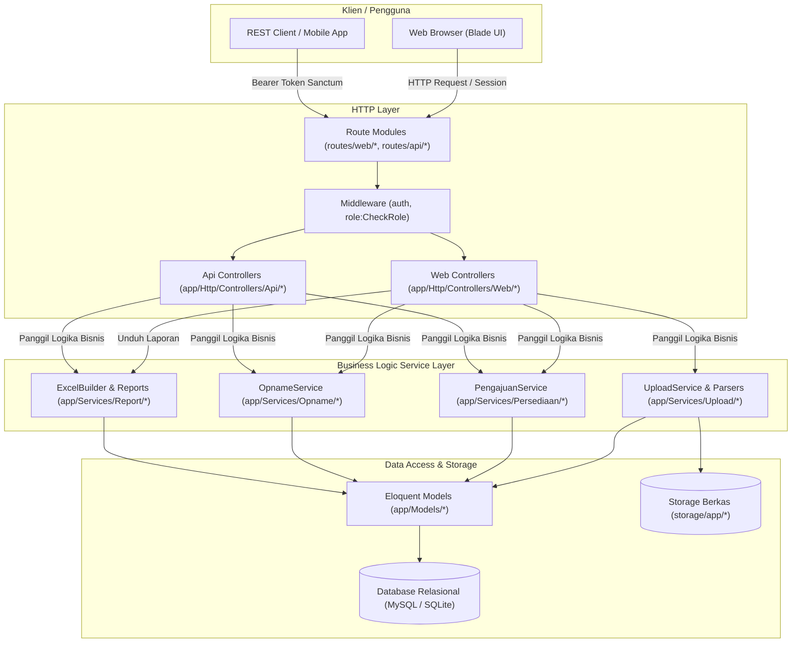
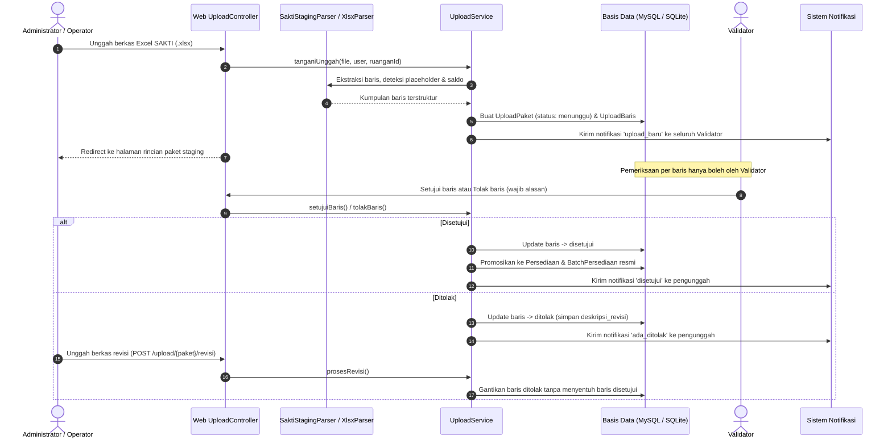
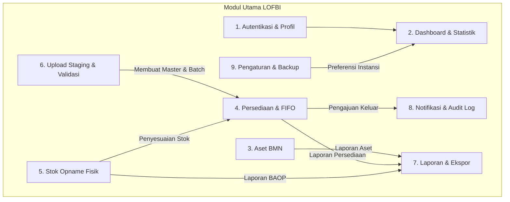

# Arsitektur Aplikasi LOFBI

Dokumen ini menjelaskan arsitektur perangkat lunak LOFBI (*Layanan Operasional & Form BMN / Inventarisasi*) pada KSOP Kelas I Banten. Aplikasi dibangun menggunakan arsitektur pragmatis Laravel: Controller tipis (*thin controller*), logika bisnis terpusat pada Service layer, dan persistensi data pada Model Eloquent.

---

## 1. Pola Arsitektur Utama (Controller -> Service -> Model)

Aplikasi LOFBI menerapkan pemisahan tanggung jawab yang tegas:
- **Controller**: Mengelola validasi request input, otorisasi peran pengguna (*CheckRole* middleware), memanggil Service layer terkait, dan mengembalikan respons HTTP (Blade View atau JSON Resource).
- **Service Layer**: Mengenkapsulasi seluruh aturan bisnis aplikasi (transaksi database multi-tabel, antrean status, kalkulasi penyusutan aset, pemotongan stok FIFO, dan audit log). Service dapat dipanggil bergantian oleh Web Controller maupun API Controller.
- **Model (Eloquent)**: Representasi skema data, relasi antar-entitas, scope pencarian, dan casting tipe data.

---

## 2. Alur Unggah Staging dan Validasi Satu Pintu

Seluruh data persediaan bersumber dari berkas eksternal resmi (format Excel SAKTI `bahan_opname_fisik.xlsx`). Tidak ada pengisian manual di luar mekanisme ini.

---

## 3. Peta Modul Aplikasi

Aplikasi terbagi ke dalam modul modular yang saling terisolasi:

### Rincian Modul
1. **Autentikasi & Profil (`app/Http/Controllers/Web/Auth/`, `app/Http/Controllers/Web/ProfileController.php`)**: Autentikasi sesi berbasis cookie untuk Web dan Bearer Token Laravel Sanctum untuk REST API.
2. **Dashboard (`app/Http/Controllers/Web/DashboardController.php`, `Api/DashboardController.php`)**: Agregasi metrik total aset, nilai perolehan, total saldo persediaan, peringatan stok menipis, dan antrean pengajuan.
3. **Aset BMN (`app/Http/Controllers/Web/AsetController.php`, `Api/AsetController.php`)**: Pengelolaan inventaris fisik BMN, nomor register/NUP, lokasi ruangan, kondisi barang, dan perhitungan nilai susut semesteran otomatis.
4. **Persediaan & FIFO (`app/Services/Persediaan/PengajuanService.php`)**: Tata kelola barang habis pakai, pemecahan per batch kedatangan, pengajuan barang keluar, serta algoritma pemotongan stok otomatis metode First In First Out.
5. **Stok Opname Fisik (`app/Services/Opname/OpnameService.php`)**: Pembukaan sesi opname per periode/ruangan, snapshot stok buku, pencatatan hasil hitung fisik lapangan, perhitungan selisih, dan persetujuan penyesuaian otomatis.
6. **Upload Staging & Validasi (`app/Services/Upload/`)**: Mekanisme gerbang satu pintu impor data bersumber dari berkas eksternal dengan tinjauan mandiri oleh Validator.
7. **Laporan & Ekspor (`app/Services/Report/ExcelBuilder.php`, `Web/ReportController.php`, `Api/LaporanController.php`)**: Penyusunan laporan resmi Berita Acara Opname Fisik (BAOP), Daftar Barang Ruangan (DBR), Nilai Buku Aset, serta ekspor file CSV/Excel RFC 4180 dan PDF DomPDF.
8. **Notifikasi Drawer & Audit Trail (`Web/NotificationController.php`, `Api/MonitoringController.php`, `Api/AuditController.php`)**: Riwayat aksi pengguna ke tabel `audit_logs` dan sistem notifikasi internal berbasis drawer dengan penandaan baca otomatis.
9. **Pengaturan & Backup (`Web/SettingController.php`, `Api/SettingsController.php`)**: Konfigurasi nama satuan kerja KSOP, format tanggal, dan pembuatan cadangan database.
